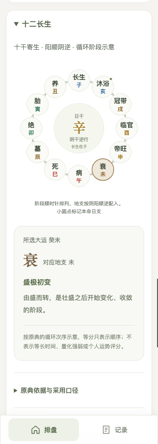

# 八字排盘：一个 HTML + 一个 JS

直接双击 [index.html](index.html) 即可运行。部署、复制或离线使用只需要这两个文件放在同一目录：

```text
index.html   页面入口
bazi.js      独立算法库 + 可选原生交互界面 + 内置历法和兼容数据
```

不需要 Node、npm、React、构建工具、服务器、CDN 或联网请求。原 Node/React 工程、依赖、构建产物和旧项目副本已经删除。

## 当前功能

- 公历、农历与闰月输入，四柱、十神、藏干、纳音、旬空和起运排盘。
- 大运 → 流年 → 流月 → 流日逐级联动，选项自动换行，无横向滚动。
- 十二长生交互循环图：点击学习阶段释义，随所选大运高亮，并标记本命日支。
- 本机保存与重放排盘记录，适配 PC、Mac、Android 和 iOS 的屏幕尺寸。
- 同一个 `bazi.js` 可独立计算，也可通过 `Bazi.mount` 嵌入完整界面；附中文教学注释。



## 在 Codex 中使用八字技能

在此仓库开启 Codex 对话，输入 `$bazi` 即可按出生资料排盘、查大运流年流月流日，或单独查询十二长生。技能使用同一份 `bazi.js` 在本机计算，需要 Node.js，无需安装 npm 依赖。出生资料由命令在本机处理。

如需在其他项目中使用，从仓库根目录执行以下命令，将技能和计算库一起复制到个人技能目录。更新时可重新执行。

```sh
bazi_skill_root="${CODEX_HOME:-$HOME/.codex}/skills"
mkdir -p "$bazi_skill_root/bazi"
cp -R .agents/skills/bazi/. "$bazi_skill_root/bazi/"
cp bazi.js THIRD-PARTY-LICENSES.txt "$bazi_skill_root/bazi/"
```

示例提示词：`$bazi 帮我排公历 1990 年 6 月 15 日 12:30 的八字，按男命排运，列出四柱和首步大运。` 输入字段和命令示例见 [八字技能说明](.agents/skills/bazi/SKILL.md)。

## 十二长生的图示依据

采用《子平真诠》正文的十干“阳顺阴逆”及土随火口径，结合《三命通会》解释十二阶段的循环。不同原典、后世评注存在论法差异，当前采用的体系在界面中明确标注。

圆环位置只表示阶段次序，不表示持续时间、量化强弱或吉凶评分；“帝旺”不直接等同吉，“病”“死”等阶段名也不直接推断疾病或寿命。点击节点可查看释义，点击大运或“跟随所选大运”恢复联动，键盘 Enter / 空格同样可操作。

文献链接、正文与后人评注的区分及图形约定见 [十二长生原典依据](research/zydx/LIFE-STAGES-SOURCES.md)。

## 当作计算库

普通 `<script>` 加载后提供全局 `Bazi`；加载库本身不会读取或修改 DOM。

```html
<script src="./bazi.js"></script>
<script>
  const chart = Bazi.calculate({
    year: 1990, month: 6, day: 15,
    hour: 12, minute: 30,
    gender: '男', calendar: 'solar'
  });

  console.log(chart.year.ganZhi, chart.month.ganZhi,
              chart.day.ganZhi, chart.time.ganZhi);
  // 庚午 壬午 辛亥 甲午
  console.log(chart.start.date);
  // 1997-11-10 22:30:00
  console.log(chart.bone, chart.relations, chart.decades);
</script>
```

也支持 CommonJS，其他项目可直接 `const Bazi = require('./bazi.js')`，无需安装依赖。浏览器 ES module 可使用 `import './bazi.js'` 后通过 `globalThis.Bazi` 调用。

输入参数：

| 参数 | 说明 |
|---|---|
| `year, month, day` | 数字，支持出生年份1902—2038 |
| `hour, minute` | 数字，默认0；公历按输入的民用钟表时间计算 |
| `gender` | `'男'` 或 `'女'`，默认男 |
| `calendar` | `'solar'` 公历或 `'lunar'` 农历，默认公历 |
| `leapMonth` | 农历闰月，布尔值 |
| `mode` | 默认 `'reference'` 对照站兼容模式；`'astronomical'` 为天文模式 |
| `daySect` | 默认1：23时换日；2：零时换日 |
| `yunSect` | 天文模式的起运算法，默认2：分钟精度；1：传统时辰法 |

兼容模式的农历入口按参考表单使用小时精度，忽略分钟；农历小月选择三十会按原站行为溢出到下一月。

主要接口：

```js
Bazi.calculate(input);          // 四柱、农历、起运、大运、胎元命宫、长生、十神、称骨、干支关系
Bazi.calculateCalendar(input);  // 基础排盘结果，不额外计算称骨和干支关系

const months = Bazi.getFortuneMonths(2026); // 十二节气流月
const days = Bazi.getFortuneDays(months[0]);
Bazi.getLifeStage('辛', '酉');              // 临官
Bazi.getLifeCycle('辛');                    // 按阶段顺序返回地支及原典释义
Bazi.getTenGod('辛', '甲');                 // 正财
Bazi.calculateEmptyPositions('辛', '亥');   // ['寅', '卯']
Bazi.getPillarRelations(pillars);           // {stems:[], branches:[]}
Bazi.getShensha(chart, {stem:'乙', branch:'酉'}, '男');
Bazi.getBone('庚午', 5, 23, 12, '男');      // 农历月、日和小时，年用四柱年干支
```

`HIDDEN_STEMS`、`SOUND_ELEMENTS`、`TEN_GODS`、干支与五行映射也可直接使用。所有计算结果均为普通 JS 对象，可序列化。

## 直接嵌入交互界面

`Bazi.mount` 是可选的原生 DOM 层。算法库不依赖它；样式会自动注入并限定在 `.bazi-host` 内。

```html
<div id="paipan"></div>
<script src="./bazi.js"></script>
<script>
  const app = Bazi.mount('#paipan', {
    input: {year:1990, month:6, day:15, hour:12, minute:30},
    name: '示例',
    // navigation: false,        // 可隐藏底部导航
    // storageKey: 'my-records'   // 可自定义本机记录键
  });

  // 也可从宿主页面直接更新排盘：
  app.calculate({year:2023, month:2, day:1, hour:12,
                 calendar:'lunar', leapMonth:true}, '农历示例', false);
  console.log(app.getState());
  // app.destroy();              // 移除自己的界面和事件监听
</script>
```

保留大运→流年→流月→流日联动、选中高亮、下级清空、男女神煞/称骨评语、重新排盘和本机记录。大运、流年、流月、流日全部自动换行，无需左右滑动；底部「十二长生」采用可点击的循环图：按日干配地支，跟随所选大运高亮阶段，并提供原典释义和来源链接。图的等分角度只表示次序，不表示时间或量化运势。记录沿用 `paipan-records`，可读取同一浏览器来源中原页面的记录。文件页面和网站属于不同来源，不会自动跨来源搬迁 localStorage。

## PC、Mac、Android、iOS 布局

宽屏采用并排命盘与信息卡片，手机改为单列；岁运选项按可用宽度调整列数，全部可见，不通过隐藏横向溢出来截断内容。月份显示节气与起始日期，流日显示公历日期、干支和农历日名。

手机输入字号16px，选择按钮留足触控尺寸；底部导航处理刘海/手势区安全距离，键盘焦点、鼠标悬停及减少动态效果偏好也分别处理。320、360、375、390、430、768、1024、1440、1920像素宽度均经过实际视口验证，无横向溢出，农历、记录和岁运联动正常。报告在`research/zydx/responsive-browser.json`；这属于Chromium桌面/触控模拟验证，不冒充Android或iOS真机测试。

## 将 bazi.js 作为教学阅读

文件头有中文导读、手算示例和五个可执行练习。搜索“第一课”至“第十二课”可按顺序阅读：

1. 干支、阴阳五行、藏干、十神与旬空。
2. 公农历转换、立春换年、十二节定月、五虎遁、日柱与五鼠遁。
3. 顺逆排运、三日一年的换算单位、起运与交运日期、历史时区。
4. 胎元、命宫、十二长生、合冲刑害、动态神煞及称骨。
5. 兼容数据、第三方历法内核、对外接口和响应式界面。

注释分别标明“常用排盘口径”“参考站实测兼容”“单纯显示逻辑”。早期异常日序、特定节气观测及字符串神煞缺陷不会被教成通用规则。四柱主流程与旺衰/格局/用神论断也有明确边界。

## 验证与历史资料

- 迁移前后284组出生输入，各核对兼容/天文两种模式，结果一致。
- 全范围1,644个节月、50,052条流日记录一致。
- 真正通过 `file://` 打开 HTML，19项原生浏览器交互检查通过，包括闰月、联动清空、本机记录、重放、多容器挂载和销毁、姓名转义。
- 库已验证可在没有DOM的全局环境及CommonJS环境中独立计算。
- 最新回归核对284组出生输入及224组称骨样本，见 [最终算法检查](research/zydx/standalone-final.json)。
- 十二长生核对全部10干 × 12支映射；循环图在320、390、1440像素视口检查了节点点击、键盘操作、焦点保持与大运联动，无横向溢出或外部页面请求，见 [循环图浏览器检查](research/zydx/life-cycle-browser.json)。

机器报告：`research/zydx/standalone-migration.json`、`research/zydx/standalone-browser.json`。`fixtures/` 和 `research/` 是不参与运行的历史样本、来源及对照报告。名人生日的测试时刻是假设值，不是已核实出生时辰，见 `research/zydx/FAMOUS-COMPARISON.md`。

已知边界继续保留：原站早期日期日柱异常仅在兼容模式复现；起运文本的24小时归一化显示；2038年末下一节气的未观测边界标记 `reference-with-fallback`；PHP本命神煞尚未完整验证。动态神煞与本命神煞不混称。

`bazi.js` 内置 `lunar-javascript 1.7.7` 的MIT历法内核，以及本项目的兼容规则、节气观测和称骨数据；不再是外部运行依赖。第三方授权同时保留在文件头和 `THIRD-PARTY-LICENSES.txt`。
